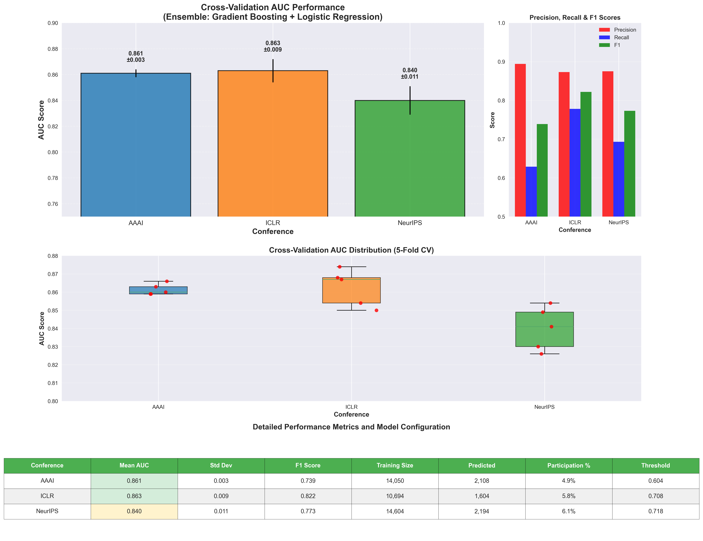

# 🎓 Scholar Scraper: ML-Powered Academic Conference Participation Prediction

**Predicting future conference participation with ensemble machine learning and temporal feature engineering.**

## 🎯 Overview

Scholar Scraper collects author data from major AI/ML venues (AAAI, NeurIPS, ICLR), builds a database of researcher profiles, and predicts which authors are likely to participate in upcoming editions of each conference.

### Key Capabilities
- **Predictive modeling** – Forecast per-author participation for AAAI 2026, NeurIPS 2025 and ICLR 2026
- **Profile enrichment** – Fuzzy-match predicted authors to a database of 60,000 scholar profiles
- **Interactive dashboard** – Streamlit app to browse, filter and analyze profiles
- **Network analysis** – Co-author networks with Gephi (`.gexf`) export
- **Data collection** – Scrapers for conference papers/authors and a Google Scholar profile crawler

## ✨ Features

### 🔮 Prediction Engine
- **Temporal features** – Exponential-decay recency weighting, Markov transition probabilities, participation rate, years since first/last appearance
- **Ensemble model** – Gradient Boosting + Logistic Regression with soft voting (`VotingClassifier`)
- **Cross-validation** – 5-fold `GroupKFold` by author to prevent leakage
- **Conservative thresholding** – Positive predictions use the 85th percentile of training-set probabilities

### 📊 Dashboard (`src/dashboard.py`)
- **Overview** – Profile statistics with country filters
- **Search** – Search and filter authors, sortable tables
- **Analytics** – H-index/citation distributions, geographic breakdowns, Singaporean co-author analysis
- **Network** – Per-author collaboration graphs with `.gexf` download
- **Downloads** – Export data

### 🔗 Data Tools
- **Profile mapping** – `scholar_profile_mapper.py` infers institutions and countries from email domains (`domain_mappings.json`, `institution_to_country_mapping.json`)
- **Excel report** – Predictions joined with scholar profiles, per-conference summaries and unmatched authors

## 🛠️ Installation

```bash
git clone https://github.com/krishnanefx/Scholar_Scraper.git
cd Scholar_Scraper

python3 -m venv .venv
source .venv/bin/activate        # Windows: .venv\Scripts\activate
pip install -r requirements.txt
pip install pyarrow openpyxl     # needed for .parquet input and .xlsx output (not in requirements.txt)
```

The Google Scholar crawler (`src/scrapers/main.py`) uses Selenium and needs Chrome + ChromeDriver (e.g. `brew install chromedriver`).

## 🚀 Quick Start

The repository already includes processed profiles (`data/processed/scholar_profiles.csv`), trained models (`data/processed/*.pkl`), predictions (`data/predictions/`) and an Excel report (`outputs/`), so you can explore results immediately:

```bash
streamlit run src/dashboard.py
```

### Regenerating predictions

The raw conference datasets in `data/raw/` are **not committed**; create them with the scrapers first:

```bash
python src/scrapers/aaai_scraper.py      # -> data/raw/aaai25_papers_authors_split.csv
python src/scrapers/neurips_scraper.py   # -> data/raw/neurips_2020_2024_combined_data.parquet (run from repo root)
cd src/scrapers && python iclr_scraper.py && cd ../..   # -> data/raw/iclr_enhanced.parquet
```

Then train and predict:

```bash
python src/models/aaai_predict_authors.py --quiet-warnings
python src/models/neurips_predict_authors.py --quiet-warnings
python src/models/iclr_predict_authors.py --quiet-warnings --data-path data/raw/iclr_enhanced.parquet
```

Each model script accepts `--data-path`, `--output-dir` and `--model-path` (ICLR/NeurIPS also read `ICLR_DATA_PATH` / `NEURIPS_DATA_PATH`). Outputs go to `data/predictions/<conf>_<year>_predictions.csv` and `data/processed/<conf>_participation_model.pkl`.

Build the Excel report:

```bash
python src/conference_predictions_summary_2026.py --year 2026 --threshold 95
# -> outputs/Conference_Predictions_with_Scholar_Profiles.xlsx
```

`--year` defaults to the current year; `--threshold` is the fuzzy-matching threshold (0–100, default 95).

### Profile maintenance

```bash
python src/scrapers/main.py                  # crawl Google Scholar profiles (seeded from a co-author BFS)
python scholar_profile_mapper.py --stats     # mapping coverage
python scholar_profile_mapper.py --fix-all   # batch-map institutions/countries
python scholar_profile_mapper.py --interactive
python show_remaining_unknowns.py            # list still-unmapped domains
```

## 📁 Project Structure

```
Scholar_Scraper/
├── src/
│   ├── models/                 # Training + prediction scripts (AAAI, NeurIPS, ICLR)
│   ├── scrapers/               # Conference scrapers + Google Scholar crawler (main.py)
│   ├── dashboard.py            # Streamlit application
│   └── conference_predictions_summary_2026.py  # Excel report builder
├── data/
│   ├── processed/              # scholar_profiles.csv, trained models (.pkl)
│   └── predictions/            # Prediction CSVs and threshold analysis plots
├── outputs/                    # Excel report and performance/participation charts
├── cache/                      # Crawler queue and lookup caches
├── scholar_profile_mapper.py   # Institution/country mapping tool
├── show_remaining_unknowns.py
├── domain_mappings.json
├── institution_to_country_mapping.json
└── requirements.txt
```

## 📊 Performance



| Conference | Authors scored | Predicted participants | CV AUC | Precision | Recall | F1 |
|------------|---------------:|-----------------------:|-------:|----------:|-------:|---:|
| **AAAI 2026** | 43,040 | 2,108 (4.9%) | **0.861** ± 0.003 | **0.894** | 0.629 | 0.739 |
| **ICLR 2026** | 27,836 | 1,604 (5.8%) | **0.863** ± 0.009 | 0.873 | **0.778** | **0.822** |
| **NeurIPS 2025** | 35,705 | 2,194 (6.1%) | 0.840 ± 0.011 | 0.875 | 0.693 | 0.773 |

In the committed Excel report, 48.7% (AAAI), 67.1% (NeurIPS) and 70.6% (ICLR) of predicted participants were matched to a scholar profile at the default fuzzy threshold of 95.

More charts: `outputs/roc_curves_actual_auc.png`, `outputs/precision_recall_f1_barcharts.png`, `outputs/detailed_model_analysis.png`, and per-conference author trends (`outputs/*_authors_per_year.png`).

## 🙏 Acknowledgments

- [Streamlit](https://streamlit.io/) for the dashboard
- [scikit-learn](https://scikit-learn.org/) for machine learning
- [NetworkX](https://networkx.org/), [Plotly](https://plotly.com/python/) and [Matplotlib](https://matplotlib.org/) for networks and charts

## 📞 Contact

**Author**: Krishnan
**Email**: krish.adaik@gmail.com
**GitHub**: [@krishnanefx](https://github.com/krishnanefx)
